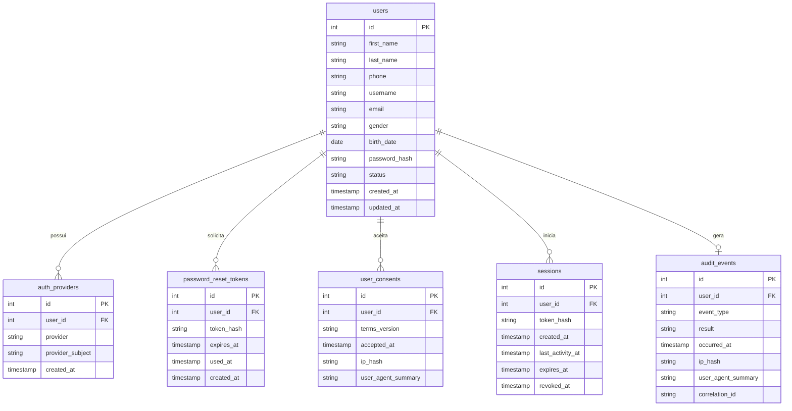

# 🛡️ Athena Nexus — Core Architecture & Security Operations

> *"Segurança com clareza e leveza."*


---

## 👩‍💻 Sobre mim

Olá! Sou **Lyvia Silva**, profissional da área de Análise de Dados e Performance, estudante de **Análise e Desenvolvimento de Sistemas (FAM)** e de **Administração de Empresas (UNIVESP)**.

Minha atuação profissional é focada em análise e performance, mas dedico parte do meu tempo livre para aprofundar conhecimentos técnicos por conta própria. O **Athena Nexus** é um desses projetos práticos, desenvolvido de forma independente com a **Squad Zeta** (fora do âmbito acadêmico). Nele, fui responsável por desenhar e estruturar a **modelagem do banco de dados relacional (DER)**, o **script DDL em SQL** e os **requisitos de segurança e auditoria**.

---

## 📌 Sobre o projeto

O **Athena Nexus** é uma aplicação web educacional desenvolvida pela Squad Zeta, focada em fornecer uma solução robusta, moderna e transparente de **Gestão de Autenticação, Controle de Sessões e Auditoria de Segurança de Usuários**.

Diferente de sistemas genéricos de login, o Athena Nexus prioriza a clareza sobre a privacidade do usuário, a gestão rigorosa de acessos, a conformidade com legislações de proteção de dados (como a **LGPD**) e um controle estrito de auditoria operacional.

---

## 🎯 Escopo da primeira etapa (MVP)

A arquitetura do Athena Nexus foi projetada para cobrir seis pilares fundamentais de segurança:

1. **Gestão e Cadastro de Usuários (`users`):** Controle completo do perfil do usuário, armazenamento seguro de dados pessoais e credenciais criptografadas (*hash*).
2. **Consentimento e Termos de Uso (`user_consents`):** Registro auditável do aceite dos Termos de Uso e Política de Privacidade, incluindo versão, timestamp e hash de IP.
3. **Autenticação Social / OAuth (`auth_providers`):** Integração com provedores externos (ex: Google OAuth 2.0), permitindo login rápido e seguro.
4. **Gerenciamento de Sessões (`sessions`):** Controle detalhado de tokens ativos, data de expiração, revogação e regra de inatividade automática após 15 minutos.
5. **Recuperação de Senha (`password_reset_tokens`):** Fluxo seguro de redefinição de senha via tokens temporários com data de expiração e consumo único.
6. **Auditoria Operacional (`audit_events`):** Rastreabilidade total de eventos críticos (logins, falhas de autenticação, trocas de senha e alterações de perfil) com ID de correlação para monitoramento de segurança.

---

## 📐 Modelagem de banco de dados (DER)

A modelagem foi estruturada com relações 1:N entre a entidade principal `users` e as tabelas operacionais e de auditoria.



> 💡 O diagrama acima é renderizado automaticamente pelo GitHub — não é necessário anexar imagem.

---

## 🗂️ Script DDL (PostgreSQL)

<details>
<summary>Clique para expandir o script completo de criação das tabelas</summary>

```sql
-- 1. Tabela de Usuários (users)
CREATE TABLE users (
    id SERIAL PRIMARY KEY,
    first_name VARCHAR(100) NOT NULL,
    last_name VARCHAR(100) NOT NULL,
    phone VARCHAR(20),
    username VARCHAR(50) UNIQUE NOT NULL,
    email VARCHAR(150) UNIQUE NOT NULL,
    gender VARCHAR(20),
    birth_date DATE,
    password_hash VARCHAR(255) NOT NULL,
    status VARCHAR(20) DEFAULT 'active',
    created_at TIMESTAMP DEFAULT CURRENT_TIMESTAMP,
    updated_at TIMESTAMP DEFAULT CURRENT_TIMESTAMP
);

-- 2. Aceite dos Termos e Consentimentos (user_consents)
CREATE TABLE user_consents (
    id SERIAL PRIMARY KEY,
    user_id INT NOT NULL REFERENCES users(id) ON DELETE CASCADE,
    terms_version VARCHAR(20) NOT NULL,
    accepted_at TIMESTAMP DEFAULT CURRENT_TIMESTAMP,
    ip_hash VARCHAR(64),
    user_agent_summary TEXT
);

-- 3. Gerenciamento de Sessões (sessions)
CREATE TABLE sessions (
    id SERIAL PRIMARY KEY,
    user_id INT NOT NULL REFERENCES users(id) ON DELETE CASCADE,
    token_hash VARCHAR(255) NOT NULL UNIQUE,
    created_at TIMESTAMP DEFAULT CURRENT_TIMESTAMP,
    last_activity_at TIMESTAMP DEFAULT CURRENT_TIMESTAMP,
    expires_at TIMESTAMP NOT NULL,
    revoked_at TIMESTAMP
);

-- 4. Tokens de Recuperação de Senha (password_reset_tokens)
CREATE TABLE password_reset_tokens (
    id SERIAL PRIMARY KEY,
    user_id INT NOT NULL REFERENCES users(id) ON DELETE CASCADE,
    token_hash VARCHAR(255) NOT NULL UNIQUE,
    expires_at TIMESTAMP NOT NULL,
    used_at TIMESTAMP,
    created_at TIMESTAMP DEFAULT CURRENT_TIMESTAMP
);

-- 5. Autenticação Social / OAuth (auth_providers)
CREATE TABLE auth_providers (
    id SERIAL PRIMARY KEY,
    user_id INT NOT NULL REFERENCES users(id) ON DELETE CASCADE,
    provider VARCHAR(50) NOT NULL, -- ex: 'google'
    provider_subject VARCHAR(255) NOT NULL,
    created_at TIMESTAMP DEFAULT CURRENT_TIMESTAMP,
    CONSTRAINT uk_provider_subject UNIQUE (provider, provider_subject)
);

-- 6. Logs de Auditoria e Segurança (audit_events)
CREATE TABLE audit_events (
    id SERIAL PRIMARY KEY,
    user_id INT REFERENCES users(id) ON DELETE SET NULL,
    event_type VARCHAR(100) NOT NULL, -- ex: 'LOGIN_SUCCESS', 'PASSWORD_RESET'
    result VARCHAR(20) NOT NULL,       -- ex: 'SUCCESS', 'FAILURE'
    occurred_at TIMESTAMP DEFAULT CURRENT_TIMESTAMP,
    ip_hash VARCHAR(64),
    user_agent_summary TEXT,
    correlation_id VARCHAR(100)
);
```

</details>

---

## 🧱 Stack técnica

- **Banco de dados:** PostgreSQL
- **Modelagem:** Mermaid (DER) + DDL nativo
- **Segurança:** hashing de senha, tokens de sessão/reset com expiração, auditoria com correlation ID
- **Conformidade:** estrutura pensada para atender princípios da LGPD (consentimento versionado, minimização de dados sensíveis armazenados em texto claro)

---

## 🗺️ Roadmap

- [x] Modelagem do banco de dados (DER)
- [x] Script DDL das 6 tabelas principais
- [ ] Camada de API REST
- [ ] Testes automatizados de segurança (ex: expiração de sessão, revogação de token)
- [ ] Documentação de endpoints

---

## 📄 Licença

Distribuído sob a licença MIT. Veja `LICENSE` para mais detalhes.

---

## 📬 Contato

**Lyvia Silva**
[LinkedIn](#) · [GitHub](#)
